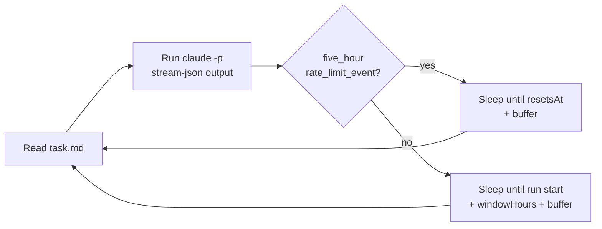

# Claude Code Scheduler

**Run Claude Code tasks unattended: automatically each time your 5-hour usage window resets, or on a date/time schedule you choose.**

[](LICENSE)


Claude Code Scheduler is a lightweight background watcher for Windows. You write a task once in a plain Markdown file. The watcher then hands that task to a fresh, non-interactive Claude Code session on your schedule, and keeps doing so until you stop it. Your usage windows get put to work even while you are away from the keyboard.

> Prefer a graphical interface? See the companion extension **[Claude Code Scheduler for VS Code](https://github.com/mohmedofficial515/claude-code-scheduler-vscode)**. It adds a scheduling panel (date/time picker, task editor, live countdown) on top of this watcher.

---

## Features

- **Window-aware scheduling.** Reads the *exact* reset time of the 5-hour usage window from Claude Code's own output, instead of guessing.
- **Date/time scheduling.** Run once at a specific moment, or repeat hourly, daily, weekly, or every *N* hours.
- **Zero-touch operation.** Runs hidden in the background and can start automatically at Windows logon, without admin rights.
- **Live task editing.** `task.md` is re-read before every run, so you can change the task at any time without restarting.
- **Graceful control.** Start, stop, and check status with one-line scripts, and nothing ever starts twice.
- **Full audit trail.** A daily watcher log plus a complete per-run transcript, including turns, cost, and session ID.
- **No dependencies.** Plain PowerShell, with no modules to install.

## How it works



1. The watcher sends the contents of `task.md` to `claude -p` through stdin, using `--output-format stream-json`.
2. Claude Code emits a `rate_limit_event` whose `rate_limit_info.resetsAt` holds the precise reset time of the current `five_hour` window.
3. The watcher sleeps until that moment plus a small safety buffer, then starts the next run.
4. If no such event is found, it falls back to *run start + `windowHours`*.

Anchoring to the real reset time keeps the schedule aligned with your actual usage window, even if you also use Claude interactively in between.

## Requirements

- Windows 10 or 11, with Windows PowerShell 5.1 or PowerShell 7+
- [Claude Code](https://code.claude.com/docs/en/overview) installed and signed in

`claude.exe` is located automatically. The watcher checks `claudePath` in the config first, then your `PATH`, and finally the newest Claude Code VS Code extension under `%USERPROFILE%\.vscode\extensions`.

## Quick start

```powershell
git clone https://github.com/mohmedofficial515/claude-code-scheduler.git
cd claude-code-scheduler
```

1. **Write your task** in `task.md`. Anything inside `<!-- HTML comments -->` is stripped before sending.
2. **Point it at your project** by setting `projectDir` in `config.json` to the folder Claude should work in.
3. **Start the watcher** in the background:

   ```powershell
   powershell -ExecutionPolicy Bypass -File .\start-watcher.ps1
   ```

4. **Check on it** at any time:

   ```powershell
   powershell -ExecutionPolicy Bypass -File .\status-watcher.ps1
   ```

To run in the foreground and watch the log live, use `.\run-watcher.ps1` instead.

## Scripts

| Script | Purpose |
|---|---|
| `start-watcher.ps1` | Starts the watcher in a hidden background process. Refuses to start a second instance. |
| `stop-watcher.ps1` | Requests a graceful stop (via `stop.flag`), then force-terminates after ~35 s if needed. |
| `status-watcher.ps1` | Shows running/stopped status and the last 20 lines of today's log. |
| `run-watcher.ps1` | The watcher loop itself. Run it directly for foreground mode. |
| `install-startup-task.ps1` | Starts the watcher automatically at every Windows logon (no admin required). |
| `uninstall-startup-task.ps1` | Removes the logon launcher. |

## Configuration

All settings live in `config.json`:

| Key | Default | Description |
|---|---|---|
| `claudePath` | `""` | Full path to `claude.exe`. Leave empty to auto-detect. |
| `projectDir` | — | Working directory for each Claude Code session. **Required.** |
| `taskFile` | `"task.md"` | Task file, relative to the scheduler folder or absolute. |
| `mode` | `"window"` | `window` (run on each usage-window reset) or `datetime` (run on a schedule). |
| `windowHours` | `5` | Window length, used for the fallback schedule. |
| `bufferMinutes` | `2` | Extra minutes to wait after a reset before running. |
| `runAtStart` | `true` | `window` mode: run immediately on start (`true`) or wait one full window first (`false`). |
| `model` | `""` | Model alias or ID (e.g. `opus`, `sonnet`). Empty uses Claude Code's default. |
| `permissionMode` | `"bypassPermissions"` | Passed to `--permission-mode`. |
| `extraArgs` | `["--dangerously-skip-permissions"]` | Additional CLI flags appended to every run. |
| `heartbeatMinutes` | `30` | How often a "still waiting" line is written to the log. |
| `emptyTaskRecheckMinutes` | `10` | `window` mode: how soon to re-check if `task.md` is empty. |
| `schedule.runAt` | `""` | `datetime` mode: first run, as `YYYY-MM-DDTHH:mm` (local time). |
| `schedule.repeat` | `"none"` | `none`, `hourly`, `daily`, `weekly`, or `everyNHours`. |
| `schedule.everyNHours` | `5` | Interval in hours when `repeat` is `everyNHours`. |

### Date/time mode examples

```jsonc
// Once, at 09:00 on 20 July 2026
"mode": "datetime",
"schedule": { "runAt": "2026-07-20T09:00", "repeat": "none" }

// Every day at 09:00
"mode": "datetime",
"schedule": { "runAt": "2026-07-20T09:00", "repeat": "daily" }

// Every 3 hours, starting 09:00
"mode": "datetime",
"schedule": { "runAt": "2026-07-20T09:00", "repeat": "everyNHours", "everyNHours": 3 }
```

For repeating schedules whose `runAt` is in the past, the watcher skips ahead to the next future occurrence. A one-time schedule set in the past runs immediately.

## Start automatically at logon

```powershell
powershell -ExecutionPolicy Bypass -File .\install-startup-task.ps1
```

This places a small hidden launcher, `ClaudeSchedulerWatcher.vbs`, in your personal Startup folder (`%APPDATA%\Microsoft\Windows\Start Menu\Programs\Startup`). It takes effect from your next logon. Run `start-watcher.ps1` to start it right away, and `uninstall-startup-task.ps1` to remove it.

## Logs

| File | Contents |
|---|---|
| `logs/watcher-YYYY-MM-DD.log` | Daily watcher log: starts, stops, schedule decisions, and a per-run summary (exit code, turns, cost, session ID). |
| `logs/run-YYYY-MM-DD_HHmmss.log` | The full `stream-json` transcript of a single run. |

## Security considerations

> [!WARNING]
> By default every run uses `--dangerously-skip-permissions`, so Claude Code can edit files and execute commands in `projectDir` **without asking for approval**. Unattended operation needs this, but you should only point the scheduler at projects and tasks you trust.

For a more conservative setup, set `permissionMode` to `acceptEdits` and clear `extraArgs`. Be aware that runs may then stall while waiting for an approval that never comes.

## Limitations

- Each run is an independent session, so no conversation context carries over between runs.
- Windows only.
- Window-aware timing depends on Claude Code reporting a `five_hour` `rate_limit_event`. When it doesn't, the fixed-interval fallback is used.

## License

Released under the [MIT License](LICENSE).

---

<sub>This is an independent community project. It is not affiliated with or endorsed by Anthropic. Claude and Claude Code are trademarks of Anthropic.</sub>
